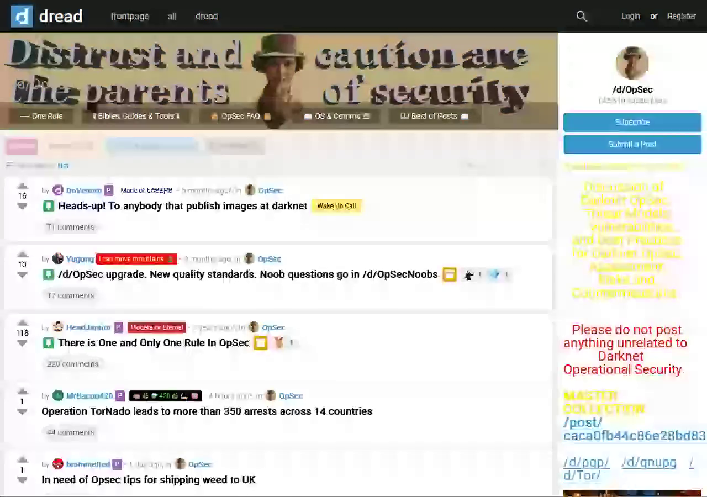
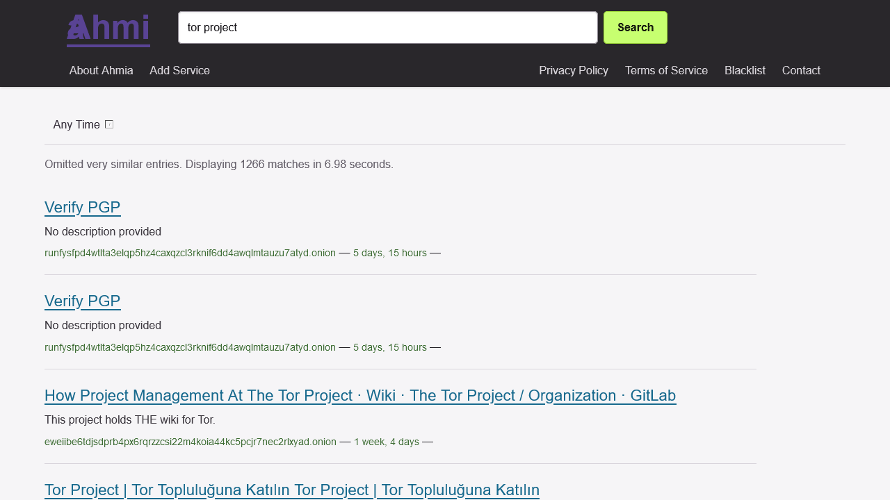
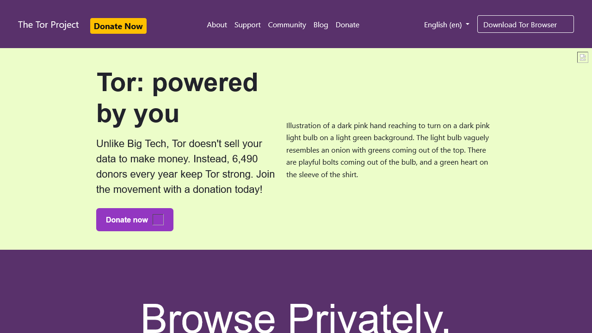

# Onion OSINT MCP

Busca en Ahmia, lee páginas públicas `.onion` y guarda resultados en un índice SQLite. Puedes usarlo desde la terminal, importarlo en Python o conectarlo a un cliente MCP.

La versión 1.5 añade un modo navegador opcional. Abre Firefox por Tor y, si una página pide iniciar sesión o resolver un CAPTCHA, puedes tomar el control de la ventana y devolverle la sesión al agente.

## Demo

[](docs/media/demo-dread.mp4)

[Ver al agente en Dread · MP4, 28 s](docs/media/demo-dread.mp4)

La grabación muestra la vista de Firefox desde que el agente abre `/d/OpSec` por Tor. Se ve la cola de acceso, la redirección automática de Dread y la carga de la página pública del foro. La toma es continua.

Estas dos capturas muestran una prueba distinta, con Ahmia y el Proyecto Tor.

| Búsqueda en Ahmia | Sitio `.onion` del Proyecto Tor |
| --- | --- |
|  |  |

## Instalación

Necesitas Python 3.10 o posterior y un proxy SOCKS de Tor. El programa busca un proxy local en los puertos `9050` y `9150`. Si no encuentra uno y localiza el ejecutable de Tor, lo arranca y lo deja en marcha para las siguientes consultas.

```bash
git clone https://github.com/jotatito05/onion-osint-mcp.git
cd onion-osint-mcp
python -m pip install -r requirements.txt
python search_onion_web.py status
```

Si quieres instalar el comando `onion-osint`, ejecuta `python -m pip install -e .`.

## Primeras consultas

```bash
python search_onion_web.py search "tor project" --max-results 5
python search_onion_web.py read "http://2gzyxa5ihm7nsggfxnu52rck2vv4rvmdlkiu3zzui5du4xyclen53wid.onion/" --max-chars 1200
python search_onion_web.py search "tor project" --local-only
```

`search` prueba primero el servicio `.onion` de Ahmia. Si falla o no devuelve coincidencias, prueba la versión pública de Ahmia a través de Tor. El índice local sirve de respaldo y también se puede consultar directamente con `--local-only`. El campo `last_seen` refleja el último avistamiento indicado por la fuente. Las alertas de posibles espejos son heurísticas.

Mira el campo `status` al leer el JSON:

| Estado | Qué significa |
| --- | --- |
| `completed` | La búsqueda en vivo terminó, aunque haya cero resultados, o el lector obtuvo una página de contenido. |
| `local_only` | La búsqueda usó solo SQLite. `degraded: true` indica que se recurrió al índice tras un fallo de la búsqueda en vivo. |
| `access_queue` / `access_challenge` | El lector encontró una cola de acceso o un reto, incluso si el servidor respondió con HTTP 200. |
| `tls_error` | No se pudo verificar el certificado HTTPS. |
| `timeout` / `connection_failed` | La operación agotó el tiempo de espera o falló la conexión. |

El CLI devuelve JSON por la salida estándar y sale con código `1` cuando `ok` es `false`.

## Conectar un cliente MCP

Inicia el servidor por stdio con el mismo Python donde instalaste las dependencias. Para clientes que usan `mcpServers`, la configuración es:

```json
{
  "mcpServers": {
    "onion-osint": {
      "command": "python",
      "args": ["/ruta/absoluta/onion-osint-mcp/search_onion_web.py", "mcp"]
    }
  }
}
```

Las herramientas de lectura son `search_onion_web`, `read_onion_page` y `check_tor_status`. Si ya usas `node index.js`, esa configuración sigue funcionando. El lanzador arranca el mismo servidor Python y no requiere `npm install`; puedes indicar el intérprete con `PYTHON_EXE`.

Para usar las funciones directamente desde Python, consulta [los ejemplos de integración](examples/agent_integrations.py). El comando `python search_onion_web.py schemas` exporta los esquemas de herramientas.

## Modo navegador

Instala Playwright y su versión de Firefox con el mismo intérprete que usa el servidor:

```bash
python -m pip install playwright
python -m playwright install firefox
```

| Herramienta | Para qué sirve |
| --- | --- |
| `onion_browser_open` | Abre una URL `.onion` y devuelve texto y un inventario de formularios. Con `visible: true` abre una ventana en tu escritorio. |
| `onion_browser_snapshot` | Lee el estado de la página abierta. Con `screenshot: true` incluye una captura PNG. |
| `onion_browser_act` | Permite acciones como rellenar campos, pulsar botones o usar un buscador. Requiere `ONION_ALLOW_INTERACTION=1` en el entorno del servidor y una petición expresa del usuario. |
| `onion_browser_close` | Cierra el navegador. Con `clear_session: true` borra las cookies guardadas. |

Para un CAPTCHA o un inicio de sesión, abre la página con `visible: true`. El MCP devuelve `awaiting_user` y deja la ventana abierta para que tú completes ese paso. Cuando termines, el agente puede llamar a `onion_browser_snapshot`. Si has cerrado la ventana, `read_onion_page` puede reutilizar las cookies guardadas para ese sitio. El proyecto no incluye un resolvedor de CAPTCHA.

Desde la terminal, `handoff` espera a que cierres la ventana o a que venza el plazo:

```bash
python search_onion_web.py handoff "http://2gzyxa5ihm7nsggfxnu52rck2vv4rvmdlkiu3zzui5du4xyclen53wid.onion/"
```

Firefox usa el proxy de Tor, pero tiene una huella distinta de Tor Browser. JavaScript está desactivado por defecto. `onion_session.json` contiene cookies que pueden dar acceso a sesiones iniciadas. Está en `.gitignore`: mantenlo fuera de informes y repositorios.

## Docker

La imagen incluye Tor y cubre la búsqueda y el lector pasivo. El modo navegador se instala en el equipo de escritorio.

```bash
docker build -t onion-osint-mcp .
docker run -i --rm -v onion-osint-data:/data onion-osint-mcp
```

El contenedor inicia el servidor MCP por stdio. El volumen conserva el índice y los datos de Tor entre ejecuciones.

## Configuración y límites

| Variable | Uso |
| --- | --- |
| `TOR_PROXY_URL` | Proxy SOCKS de Tor, por ejemplo `socks5h://127.0.0.1:9050`. |
| `TOR_SOCKS_HOST`, `TOR_SOCKS_PORT` | Host y puerto cuando no defines `TOR_PROXY_URL`. |
| `TOR_EXE_PATH`, `TOR_DATA_DIR` | Ruta al ejecutable y directorio de datos del Tor que arranca el programa. |
| `ONION_INDEX_DB` | Ruta al índice SQLite. Por defecto, `onion_index.db` junto al script. |
| `ONION_MAX_RESPONSE_BYTES` | Límite de descarga del lector pasivo. Por defecto, 3 MiB. |
| `ONION_USER_AGENT` | Identificador de cliente que se envía en las peticiones. |
| `ONION_ALLOW_INTERACTION` | Con `1`, habilita `onion_browser_act`. |
| `ONION_BROWSER_JAVASCRIPT` | Con `1`, activa JavaScript en Firefox. |
| `ONION_SESSION_FILE` | Ruta al archivo de cookies. Por defecto, `onion_session.json` junto al script. |

El lector pasivo valida las direcciones `.onion` v3, sigue hasta cinco redirecciones dentro de `.onion` y quita scripts, formularios y elementos ocultos del texto. En el modo navegador, Firefox puede llegar a solicitar por Tor el destino de una redirección HTTP fuera de `.onion` antes de que la herramienta descarte la página.

El texto extraído y los fragmentos de búsqueda vienen de terceros. Trátalos como datos sin verificar, también cuando los pases a un agente.

## Pruebas y licencia

```bash
python -m unittest discover -s tests -v
```

Las pruebas no necesitan Tor. Las de navegador usan un sitio local y requieren Playwright y Firefox. Consulta [AGENTS.md](AGENTS.md) para las pautas de desarrollo. Licencia [MIT](LICENSE).
