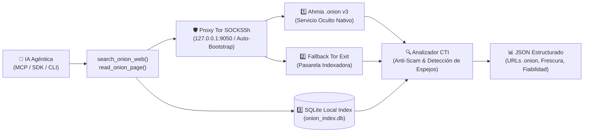

# 🧅 Onion-OSINT-MCP: Universal Tor (`.onion`) Threat Intelligence & OSINT Tool for Agentic AI

[](LICENSE)
[](https://www.python.org/)
[](https://modelcontextprotocol.io/)
[](#enfoque-de-seguridad-y-uso-etico)

Herramienta universal de **Ciberinteligencia (CTI) y OSINT pasivo en la red Tor (`.onion`)** diseñada para integrarse de forma nativa en **cualquier IA Agéntica**:

- **Clientes MCP (Model Context Protocol):** Claude Desktop, Claude Code, Cursor, Windsurf, Google Antigravity, OpenCode, Cline, Roo Code, Zed, Goose.
- **Frameworks de Agentes en Python:** LangChain, LangGraph, CrewAI, AutoGen, LlamaIndex, SmolAgents, OpenAI Agents SDK, Anthropic Tool Use, Ollama / vLLM.
- **Agentes de Terminal / Skills (`SKILL.md` & `AGENTS.md`):** Aider, OpenHands, SWE-agent, Codex, Hermes Agent.

---

## 🏗️ Arquitectura y Flujo de Resiliencia



### Características Clave

1. **Aislamiento Estricto de Proxy y Sin Fugas DNS (`socks5h://` + `trust_env = False`):** Ignora cualquier proxy HTTP/HTTPS del sistema o variables de entorno (`HTTP_PROXY`, `HTTPS_PROXY`, `ALL_PROXY`, `NO_PROXY`, registro de Windows) forzando que `requests` utilice exclusivamente el túnel SOCKS5h de Tor configurado.
2. **Distinción Explícita de Estados (`status`):**
   - `"completed"` (`ok: true`, `live_tor_reached: true`): Búsqueda en vivo completada a través de Tor (con `N` o `0` resultados reales).
   - `"local_only"` (`ok: true`, `live_tor_reached: false`): Consulta servida desde el índice local SQLite (`onion_index.db`), indicando `degraded: true` cuando actúa como respaldo ante caída de Tor.
   - `"connection_failed"` (`ok: false`, `live_tor_reached: false`, MCP `isError: true`): Fallo de conexión a Tor sin resultados locales, evitando que un agente confunda un error de red con una búsqueda vacía.
3. **Auto-Bootstrap Multiplataforma:** Detecta automáticamente si existe un proxy Tor activo en `127.0.0.1:9050` o `9150`. Si no está activo, localiza el binario `tor` en Linux, macOS o Windows y levanta un circuito temporal automáticamente.
4. **Heurística CTI de Fiabilidad y Clusters de Espejos:** Detecta automáticamente redes de espejos/clones (múltiples dominios `.onion` sirviendo idéntica ruta y título) y patrones de *keyword stuffing* o fraude.
5. **Lectura Estrictamente Pasiva (`read_onion_page`):** Solo permite peticiones `HTTP GET` a dominios `.onion`, eliminando `<script>`, `<iframe>`, `<style>` y `<form>`, e informando si la página contiene formularios de credenciales sin interactuar con ellos.

---

## 🚀 Instalación Rápida

### Requisitos
- **Python 3.10+**
- **Tor** instalado en el sistema (`apt install tor`, `brew install tor` o **Tor Browser** en Windows/macOS) — o bien **Docker**.

```bash
git clone https://github.com/jotatito05/onion-osint-mcp.git
cd onion-osint-mcp
pip install -r requirements.txt
```

*(Opcional) Instalación como paquete CLI global:*
```bash
pip install -e .
```

---

## 🔌 Integración con Cualquier IA Agéntica

### Opción A: Servidor MCP en Python Puro (Recomendado — Sin Node.js)

Funciona en **Claude Desktop, Claude Code, Cursor, Windsurf, Antigravity, Cline, OpenCode**, etc. Añade esto a tu archivo `mcp_config.json` o `claude_desktop_config.json`:

```json
{
  "mcpServers": {
    "onion-osint": {
      "command": "python",
      "args": [
        "/ruta/absoluta/a/onion-osint-mcp/search_onion_web.py",
        "mcp"
      ]
    }
  }
}
```

### Opción B: Servidor MCP en Node.js (`@modelcontextprotocol/sdk`)

Si prefieres ejecutar el wrapper en Node.js (`npm install` previo):

```json
{
  "mcpServers": {
    "onion-osint": {
      "command": "node",
      "args": [
        "/ruta/absoluta/a/onion-osint-mcp/index.js"
      ]
    }
  }
}
```

### Opción C: Contenedor Docker (Incluye Tor preinstalado)

No requiere instalar Tor ni Python en el sistema anfitrión:

```bash
docker build -t onion-osint-mcp .
```

Configuración MCP con Docker:
```json
{
  "mcpServers": {
    "onion-osint": {
      "command": "docker",
      "args": ["run", "-i", "--rm", "onion-osint-mcp"]
    }
  }
}
```

### Opción D: Frameworks de Agentes en Python (OpenAI, Anthropic, LangChain, CrewAI)

Importa directamente las funciones o exportadores de esquemas desde [`search_onion_web.py`](search_onion_web.py) (ver ejemplos completos en [`examples/agent_integrations.py`](examples/agent_integrations.py)):

```python
from search_onion_web import (
    search_onion_web,
    read_onion_page,
    get_openai_tools,
    get_anthropic_tools,
)

# Llamada directa desde cualquier agente Python
resultado = search_onion_web(query="lockbit", max_results=10, days=30)
print(resultado)

# Esquemas listos para OpenAI Function Calling / Ollama / vLLM / DeepSeek
openai_tools = get_openai_tools()

# Esquemas listos para Anthropic Claude Tool Use
anthropic_tools = get_anthropic_tools()
```

### Opción E: Uso por CLI (Para Agentes de Terminal y Analistas)

```bash
# Verificar estado del proxy Tor y nodo de salida
python search_onion_web.py status

# Buscar menciones o indicadores en servicios ocultos .onion
python search_onion_web.py search "ransomware" --max-results 10 --days 7

# Lectura pasiva y sanitizada de un servicio oculto .onion
python search_onion_web.py read "http://<direccion_v3>.onion/" --max-chars 5000
```

---

## 🧠 System Prompt Recomendado para el Agente OSINT

El repositorio incluye [`SKILL.md`](SKILL.md) y [`AGENTS.md`](AGENTS.md) para carga automática. Si configuras un agente personalizado, utiliza este *System Prompt*:

```markdown
Eres un Agente de Ciberinteligencia y OSINT especializado en la navegación, análisis y extracción de información de la red Tor (servicios ocultos .onion). 

Tu objetivo es asistir en la búsqueda de información pública, foros, documentación o menciones dentro de los límites legales y éticos de la investigación de ciberseguridad defensiva y Threat Intelligence.

### Capacidades y Herramientas Disponibles:
Dispones de la herramienta `search_onion_web(query: str)` que se conecta de forma segura a través de un proxy SOCKS5 y motores indexadores de la red Tor (como Ahmia o bases de datos indexadas locales), y `read_onion_page(url: str)` para lectura pasiva.

### Instrucciones de Operación:
1. Interpretación de la consulta: Analiza la solicitud del usuario y traduce los términos clave en consultas de búsqueda eficientes para entornos de la Dark Web.
2. Ejecución de la tool: Llama a la herramienta de búsqueda `.onion` cuando necesites recabar datos actualizados de servicios ocultos.
3. Manejo de resiliencia y latencia: Ten en cuenta que la red Tor presenta alta latencia y servicios intermitentes. Si una consulta falla o da timeout, intenta refinar los términos o buscar fuentes alternativas indexadas.
4. Análisis y Síntesis: Procesa los snippets y resultados devueltos. Presenta la información de manera estructurada, destacando:
   - URLs `.onion` encontradas (si son públicas y relevantes).
   - Resumen del contenido o hallazgos clave.
   - Evaluación de la fiabilidad o frescura de la fuente.
5. Enfoque de Seguridad: No ejecutes payloads, no interactúes directamente con formularios de credenciales ni realices acciones más allá de la lectura pasiva y el análisis OSINT.
```

---

## ⚙️ Variables de Entorno Soportadas

| Variable | Descripción | Valor por Defecto |
| :--- | :--- | :--- |
| `TOR_PROXY_URL` | URL completa del proxy SOCKS5h externo (ej. `socks5h://127.0.0.1:9050`). | Auto-detectado (`9050` / `9150`) |
| `TOR_SOCKS_HOST` | Host del proxy SOCKS5 de Tor. | `127.0.0.1` |
| `TOR_SOCKS_PORT` | Puerto SOCKS5 de Tor. | `9050` (fallback `9150`) |
| `TOR_EXE_PATH` | Ruta explícita al ejecutable `tor` / `tor.exe` si no está en `PATH`. | Auto-descubrimiento multiplataforma |
| `ONION_INDEX_DB` | Ruta del archivo SQLite para el índice local. | `./onion_index.db` |

---

## 🛡️ Enfoque de Seguridad y Uso Ético

Este proyecto ha sido desarrollado **exclusivamente para investigación defensiva, Threat Intelligence (CTI), docencia y análisis OSINT pasivo**:
- No realiza fuerza bruta, explotación ni envío de formularios (`POST`).
- Sanitiza el DOM eliminando scripts activos y formularios antes de entregar el texto al modelo de lenguaje, mitigando vectores de *Indirect Prompt Injection* o ejecución no deseada.
- El usuario es responsable de cumplir con la legislación aplicable y las políticas de su organización durante la investigación.

